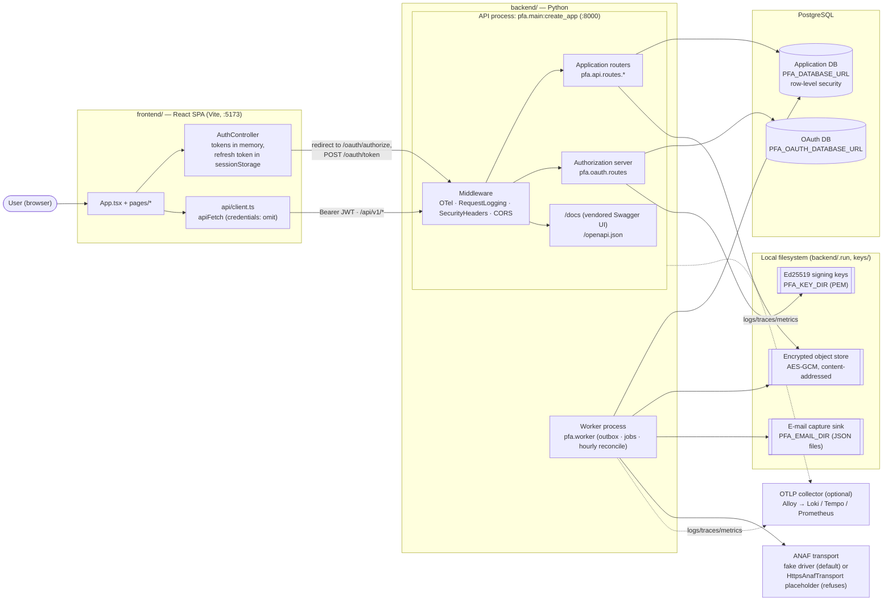
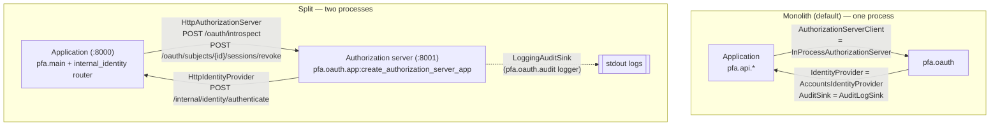
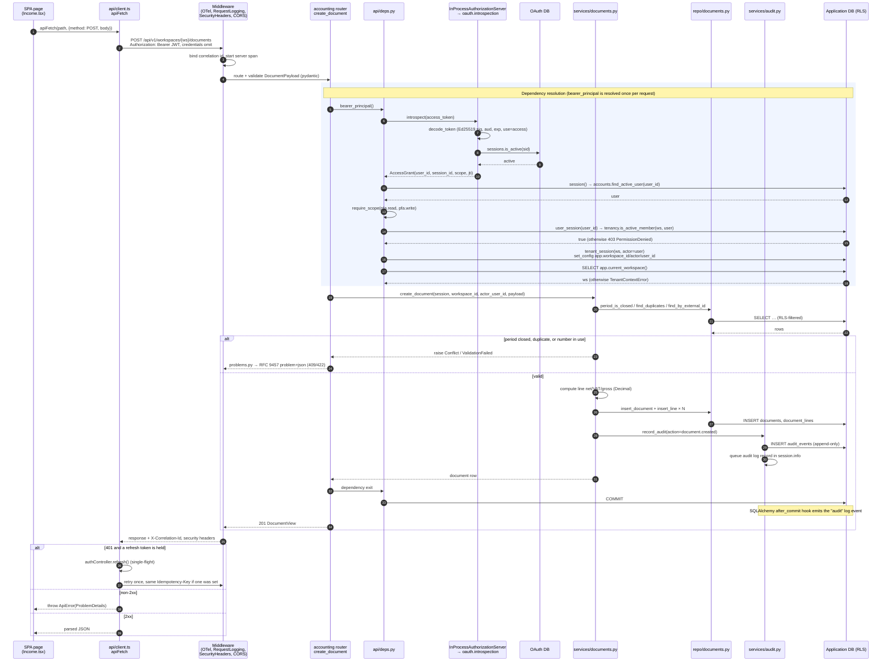
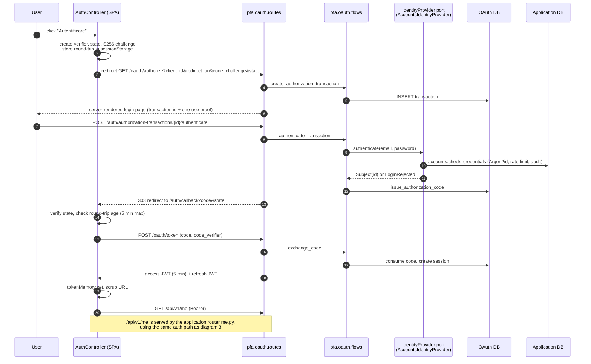
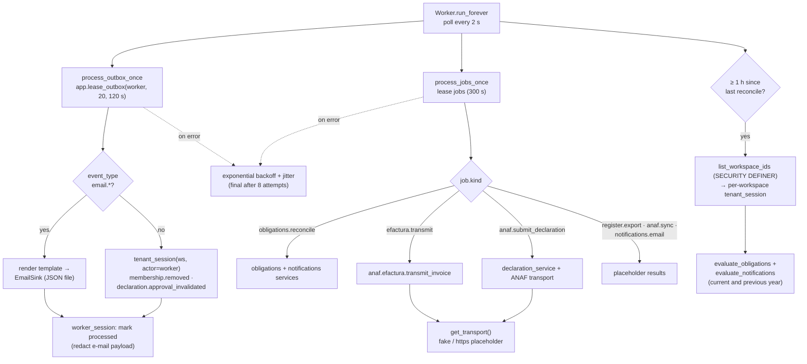
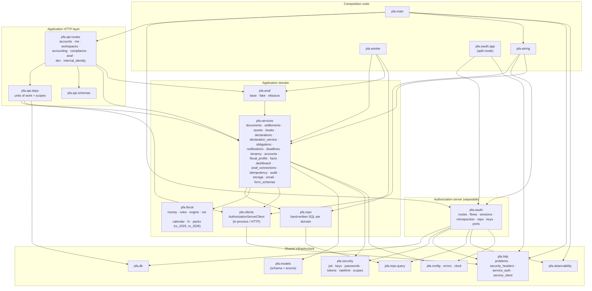
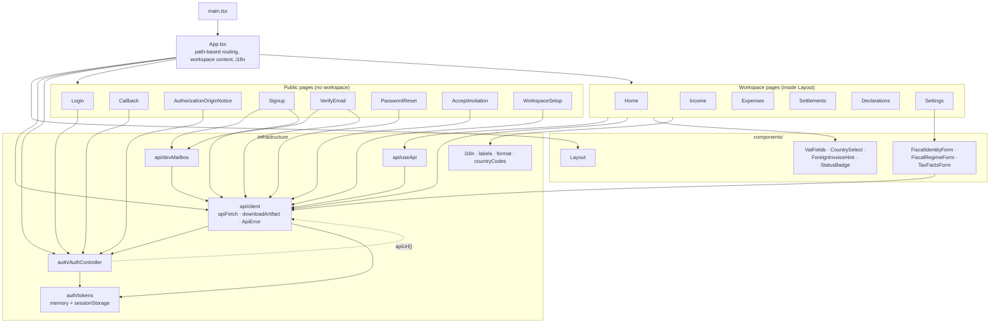

# PFA Accounting — Architecture

These diagrams are taken from the code, not from the READMEs. Each one names the
modules it was drawn from so it can be checked and kept up to date.

| # | Diagram | Main sources |
|---|---|---|
| 1 | [High-level architecture](#1-high-level-architecture) | `backend/pfa/main.py`, `wiring.py`, `worker.py`, `db.py`, `frontend/src/api/client.ts` |
| 2 | [Deployment shapes: monolith vs split](#2-deployment-shapes-monolith-vs-split) | `backend/pfa/wiring.py`, `oauth/app.py`, `clients/authorization_server_http.py` |
| 3 | [Main request flow: create a document](#3-main-request-flow-create-a-document) | `api/routes/accounting.py`, `api/deps.py`, `oauth/introspection.py`, `services/documents.py` |
| 4 | [Supporting flow: sign-in (OAuth code + PKCE)](#4-supporting-flow-sign-in-oauth-code--pkce) | `frontend/src/auth/AuthController.ts`, `backend/pfa/oauth/routes.py` |
| 5 | [Supporting flow: background worker](#5-supporting-flow-background-worker) | `backend/pfa/worker.py`, `services/audit.py` |
| 6 | [Backend component dependencies](#6-backend-component-dependencies) | `import` statements under `backend/pfa/` |
| 7 | [Frontend component dependencies](#7-frontend-component-dependencies) | `import` statements under `frontend/src/` |

---

## 1. High-level architecture

There are two independent projects. `frontend/` is a React SPA that acts as a
public OAuth client. `backend/` is a FastAPI modular monolith plus a separate
worker process. They talk only over HTTP: CORS without credentials, bearer tokens,
and no cookies.

Notes, each checked against the code:

* `pfa/main.py` mounts the application routers and the OAuth routers on one ASGI
  app. They are connected only through ports configured by `pfa/wiring.py`.
* `pfa/db.py` sets the RLS tenant context with
  `set_config('app.workspace_id' | 'app.actor' | 'app.user_id', …, true)`. The
  context is transaction-local.
* `pfa/anaf/__init__.py:get_transport()` returns `FakeAnafTransport` when
  `anaf_driver == "fake"`. Otherwise it returns `HttpsAnafTransport`, which refuses
  every call until a verified connector capability exists.
* `services/email.py:EmailSink` writes one JSON file per message. No SMTP sender
  is implemented.

---

## 2. Deployment shapes: monolith vs split

`pfa.wiring.wire(settings)` picks the adapters. The deciding setting is
`settings.authorization_server_is_remote` (`PFA_AUTHORIZATION_SERVER_URL` is set).

In split mode both sides authenticate each other with
`PFA_INTERNAL_SERVICE_TOKEN` (`pfa/http/service_auth.py`, `pfa/http/service_client.py`).
The application then serves no `/oauth/*` routes and holds no signing keys.

---

## 3. Main request flow: create a document

This is the request behind the Income and Expenses pages:
`POST /api/v1/workspaces/{workspace_id}/documents`, sent by
`frontend/src/pages/Income.tsx` through `apiFetch`. It shows the path every
authenticated, workspace-scoped write takes: token introspection, account check,
membership check, RLS tenant session, service, repository, audit, then commit.
The diagram shows the default monolith wiring.

Other workspace-scoped mutations follow the same skeleton. They swap in a
different `deps` scope (`admin_workspace_session`, `declaration_scope`,
`job_scope`, …) and service. Some, such as declaration export or submission, also
wrap the service call in `services/idempotency.execute_idempotent` or write to
the outbox with `emit_event` / `enqueue_job`.

---

## 4. Supporting flow: sign-in (OAuth code + PKCE)

The access token used in diagram 3 comes from this flow. No cookies are
involved: the authorization transaction is stored in the OAuth DB.

---

## 5. Supporting flow: background worker

`pfa/worker.py` handles every asynchronous side effect that request handlers
schedule through the transactional outbox (`emit_event`) and the job queue
(`enqueue_job`) in `services/audit.py`.

---

## 6. Backend component dependencies

Arrows mean "imports". `tests/test_architecture.py` enforces these layering
rules:

* routers never import `pfa.db`, repositories or SQLAlchemy;
* only `pfa.main` and `pfa.wiring` import both `pfa.oauth` and the application;
* `pfa.oauth` imports shared infrastructure only.

Observations from the imports:

* `pfa.fiscal` imports nothing outside itself. It has no HTTP, database or UI
  dependency, which keeps it unit-testable.
* `pfa.repo.*` modules import only `pfa.repo.query`. Services choose the queries,
  and repos run them.
* `pfa.anaf.efactura` imports `services.audit`, `services.deadlines`,
  `services.storage` and `services.xmlutil`. ANAF and services therefore depend on
  each other in both directions (`services.anaf_connections` imports
  `anaf.efactura`).
* `services.declaration_service` holds the declaration workflow (approve, export,
  submit). `services.declarations` holds the calculation and generators on top of
  `pfa.fiscal`.

---

## 7. Frontend component dependencies

The router is hand-rolled: `App.tsx` switches on `window.location.pathname`.
`src/api/schema.ts` is generated from `openapi.json` (`npm run generate:types`),
but no module imports it yet.

`api/client.ts` and `auth/AuthController.ts` import each other.
`apiFetch` calls `authController.refresh()` on a 401. `AuthController` uses
`apiUrl()` to reach `/api/v1/me` and `/api/v1/sessions/logout` on the API origin.
